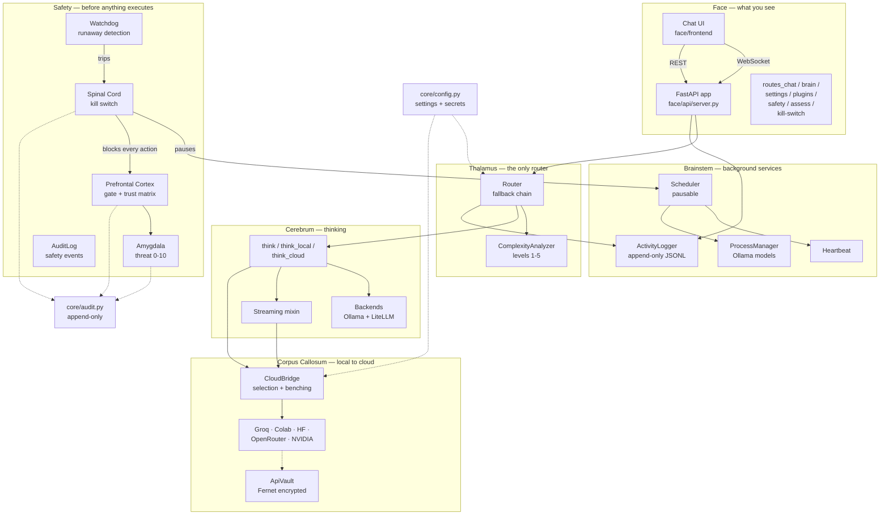
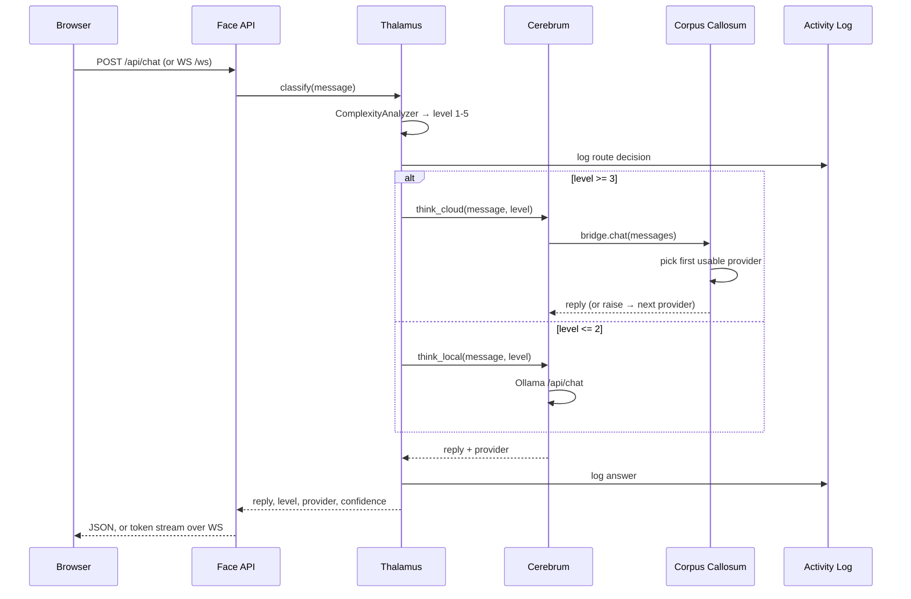

# ZUZZ Architecture

How the pieces built so far fit together, and what is still planned. Written
after Phase 1; updated as later phases land.

---

## 1. Components Built So Far



---

## 2. Request Flow

A chat message travels this path. No component may skip the Thalamus.



### Fallback chain

A failure at one level cascades downward rather than failing the request:

| Classified level | Attempt order |
|---|---|
| 1 or 2 (local) | chosen → 2 → 3 (cloud) → 1 |
| 3 to 5 (cloud) | chosen → 2 → 1 |
| Any level, no cloud credential | local only |
| Any level, no internet | local only |

Cloud levels are skipped entirely when no provider key is configured, so a
local-only machine never makes a doomed network call.

---

## 3. Where the Connectors Fit

`Cerebrum.think_cloud` has two paths:

1. **Dedicated connectors** (preferred) — `CloudBridge` walks the configured
   order and calls the provider directly. This gives per-provider rate-limit
   tracking, benching after hard failures, tailored error messages and provider
   status for the dashboard.
2. **LiteLLM** (fallback) — used only if every connector fails, for any provider
   without a dedicated connector yet.

| Connector | Speaks | Quota tracked | Notes |
|---|---|---|---|
| Groq | OpenAI schema | 30/min | Default cloud brain, LLaMA 70B |
| Colab | Custom Flask | none | ngrok URL *is* the credential; URL changes per session |
| HuggingFace | Flat `inputs` | 20/min | Messages flattened to one prompt string |
| OpenRouter | OpenAI schema | 20/min | Defaults to a free-tier model |
| NVIDIA | OpenAI schema | 40/min | No key configured yet |

Provider state on the dashboard:

| State | Meaning |
|---|---|
| `unconfigured` | No credential in `.env` |
| `untested` | Configured, but nothing has called it yet |
| `healthy` | A call came back successfully |
| `degraded` | One failure, still usable |
| `offline` | Two or more consecutive failures, benched for 120s |
| `rate_limited` | Local quota exhausted, or upstream returned HTTP 429 |

### Why `untested` exists

`untested` is not cosmetic. Provider health used to be derived from the failure
count alone, so a provider with zero failures was reported `healthy` — and a
provider with zero failures includes every provider nobody has called yet,
including one that is completely down. On this project that produced five green
dots on a dashboard where Colab was returning HTTP 404.

**Zero failures is not evidence of health. Absence of evidence is not evidence
of absence of failure.** Health now requires positive evidence: `answered` is set
only by `record_success`, and the `untested` state means "configured, not yet
called". A failure replaces it immediately, so the state degrades as soon as
there is anything to degrade on.

This matters more as ZUZZ gains providers and routing paths, because the
dashboard's job is to reveal failure, not to look reassuring.

---

## 4. Credentials

Secrets live in `.env` (git-ignored). `core/config.py` loads it once at import,
so provider detection never depends on which component read first.

Accepted aliases, so a hand-written `.env` works either way:

| Canonical | Also accepted |
|---|---|
| `OLLAMA_HOST` | `OLLAMA_URL` |
| `HUGGINGFACE_API_KEY` | `HF_API_KEY`, `HUGGINGFACE_TOKEN` |
| `COLAB_API_URL` | `COLAB_URL`, `NGROK_URL` |
| `ZUZZ_PORT` | `WEB_PORT` |

`ApiVault` can seal credentials with Fernet encryption into
`storage/vault.json`. The key lives in `storage/.vault_key`; losing it makes the
vault unrecoverable by design. This is groundwork for Phase 2's dashboard key
entry — connectors read from the environment today.

---

## 5. Built vs Planned

| Component | Phase | Status |
|---|---|---|
| Cerebrum (local + cloud + streaming) | 1 | Built |
| Thalamus (routing, fallback, benching) | 1 | Built |
| Brainstem (server, log, heartbeat, scheduler) | 1 | Built |
| Face (API + streaming chat UI) | 1 | Built |
| Corpus Callosum (5 connectors + bridge) | 1 | Built |
| API vault (Fernet) | 1 | Built, not yet wired to the UI |
| Prefrontal Cortex (permission gate) | 2 | Built — matrix, immutable rules, escalating trust changes |
| Amygdala (threat detection) | 2 | Built — 0-10 scoring, context-aware, veto + audit trail |
| Spinal Cord (kill switch) | 2 | Built — flag file, gate block, watchdog, hotkey process, Stop button |
| Body: fingers (files, folders) | 2 | Built — Step 4, gated file operations |
| Body: hands (desktop control) | 5 | Built — Step 5, gated mouse, keyboard, clipboard, apps, windows |
| Body: mouth (speak) | 2 | Folder only |
| Hypothalamus (resource manager) | 2 | Partial — process manager exists |
| Occipital Lobe (vision) | 3 | Folder only |
| Body: legs (browser) | 3 | Folder only |
| Hippocampus (memory) | 6 | Folder only — history is RAM-only today |
| Basal Ganglia, Cerebellum | 6 | Folders only |
| Multi-agent, plugins | 7 | Folders only |
| Communication hub | 8 | Folders only |

---

## 6. The Safety Chain

Phase 2 added a gate between the brain's intent and the machine, and an emergency
stop in front of it. The Body layer (Step 4 for files, Step 5 for the desktop)
is what finally executes, and it is the only code in the project permitted to
touch the disk or drive the desktop.

```
Action
  -> KillSwitch.is_killed()   checked FIRST; true means blocked, no further checks
  -> Amygdala.assess()        score 0-10, context-aware
  -> PermissionGate.decide()  immutable rules -> matrix -> target override
  -> PermissionDecision       auto / ask / blocked, plus the threat
  -> Body (Fingers)           re-checks, then executes
```

The kill switch is first because a stop that still consults the matrix is not a
stop. While the flag is set, every action is `blocked` with no further checks: no
trust level and no threat score reaches it, and there is no confirmation dialog to
click through. `PermissionGate()` with no arguments uses the process-wide switch,
so the stop cannot be bypassed by forgetting to pass it.

The Amygdala runs **after** the switch check and may only ever *raise*
scrutiny. It can block a `forbidden` action at any trust level, and it can force
confirmation that the matrix would have allowed. It cannot make anything easier.

Two rules cut across the matrix:

- **A forbidden score blocks**, at trust level 5 as much as at level 1.
- **A dangerous score, or any destructive pattern, always asks** — implementing
  immutable rule R4. Trust level 5 is autonomy over *routine* work, not
  permission to `rm -rf node_modules` silently.

Scores and levels:

| Level | Score | Effect |
|---|---|---|
| `safe` | 0-2 | Matrix decides |
| `caution` | 3-5 | Matrix decides |
| `dangerous` | 6-8 | Always confirm, any trust level |
| `forbidden` | 9-10 | Blocked, any trust level |

### Context, not just regex

Each pattern in `config/danger_patterns.json` declares which action categories it
applies to, so a file called `docs/reg delete.txt` is never treated as a registry
command. When a pattern matches the text but does not apply, the skip is recorded
in the assessment's `context` notes — silently ignoring a match would make a
score impossible to audit.

### Two logs, on purpose

| Log | Path | Contents |
|---|---|---|
| Activity | `storage/logs/activity_log.jsonl` | Everything: chat, routing, provider state |
| Audit | `storage/logs/audit_log.jsonl` | Safety-critical events only |

The audit log holds blocked actions, forbidden vetoes, confirmation prompts and
their outcomes, trust level changes, kill switch events, rule violations and
threat assessments. It refuses any other event type, so routine activity cannot
dilute the record a security review reads.

---

## 7. The Spinal Cord

The emergency stop. Five small modules, deliberately separate from each other and
from the rest of the safety layer.

| Module | Responsibility |
|---|---|
| `stop_state.py` | Where the flags live and how they are written |
| `reset_policy.py` | The rules for re-arming the machine |
| `kill_switch.py` | `trigger` / `is_killed` / `reset` |
| `switch_status.py` | The payload the UI polls |
| `stop_scope.py` | What the stop actually stops |
| `watchdog.py` | Automatic detection of runaway work |
| `emergency_stop.py` | The out-of-process `Ctrl+Shift+Q` listener |

### The flag survives a restart

The stop is a **file**, not an in-memory boolean. If ZUZZ crashes while stopped
and comes back up, it comes back stopped — an in-memory flag would quietly re-arm
the machine. The flag is written to two locations (`storage/stop.flag` and the
system temp directory) so a single deleted or locked file cannot disarm it.

The flag carries the timestamp, source and reason, so the UI can explain *why*
ZUZZ stopped rather than only that it did.

### Nothing self-heals

Only `reset()` clears the flag, and it requires a typed `RESET` plus an explicit
confirmation. An agent that could un-kill itself could recover from the runaway
loop that triggered the stop. Resets repeat within an hour wait progressively
longer — 0s, 5s, 30s, 60s — which slows a toggle loop without penalising a single
ordinary stop.

### Fail safe on the reset path

If a flag cannot be deleted, the reset **refuses** and says ZUZZ stays stopped.
Reporting a successful reset while a flag survives is the dangerous direction: the
UI would say running while the gate still denies everything.

### What the stop reaches

Setting the flag is only half the job, so `StopScope` carries the stop out:

| Target | Behaviour |
|---|---|
| Local interactive actions | Denied by the gate; nothing else needed |
| Local scheduled jobs | Paused — a runaway job may be the cause |
| Local background processes | Terminated, politely then hard after 2s |
| Cloud agents | **Flagged.** They cannot be killed remotely |
| Reset | Manual UI action only |

Pausing the scheduler keeps the job registry, so a job registered *during* the
stop runs again after the reset. `/api/providers` reports `kill_switch_active` —
deliberately distinct from `degraded` or `unconfigured`, because a paused cloud
agent should read as intentional, not as a broken account.

### The watchdog

Six signals, all tripping the same switch. All four of the newer ones are
counted from the activity log rather than by watching the machine, so the
watchdog sees what *ZUZZ* did and not what the user did — a person clicking
quickly must not stop the agent.

- **CPU saturation**, requiring a *streak* of consecutive saturated polls. One
  poll can be a legitimate model load.
- **Mass file deletion** (25 in 60s).
- **Click bursts** (50 in 10s) and **keystroke bursts** (500 in 10s) — a
  runaway input loop, not a person.
- **Application launches** (10 in 60s) — a spawn loop.
- **Refused hotkeys** (3 in 60s). The limit is deliberately above 1: one
  refusal is the blocklist working, and a run of them is an agent working
  through a blocklist, which is what trips.

The four action-name sets are mutually exclusive as substrings, and that is
load-bearing. `"hotkey_blocked"` contains `"key"`, so a refused hotkey would
also count as a burst of keystrokes — letting an agent trip the keystroke signal
by having its keystrokes *refused*, which would punish ZUZZ for the safe
outcome. Refusals are logged as `combo_refused`, sharing no fragment with the
other sets.

The watchdog only ever trips the switch; it has no reset path. A detector that
could clear its own alarm would be no detector.

### Why the hotkey is a separate process

`emergency_stop.py` imports only the flag helpers and the process terminator — no
gate, no audit log, no configuration. If the brain is the thing that has gone
wrong, a hotkey handled inside that process is a hotkey that will never fire. The
front end also carries a Stop button, because a global hotkey is easy to forget.

### Known limit

The switch is only as strong as files an agent cannot reach: deleting both flag
files by hand does re-arm it. That limit is pinned by a test rather than left
implicit. What holds the line is that the reset path refuses without a human, and
immutable rule R1 protects the storage directory.

---

## 8. The Body Layer Pattern

The Body is the only code in ZUZZ that touches the disk. It has one rule, and the
rule is in the type signatures rather than in a convention anyone has to remember:

> **Every Body method takes a `PermissionDecision` as its first parameter.**

### The gate is enforced by signature, not by convention

```python
# Correct. There is no way to call this without a decision, because
# there is no overload, no default and no keyword escape.
def read(self, decision: PermissionDecision, path: str) -> str:
    ...

# Wrong. This is the shape that lets an agent reach the disk with
# whatever arguments it likes. It does not exist in body/fingers.
def read(path: str) -> str:
    ...
```

A test reads the signatures rather than trusting this comment:
`test_no_body_method_is_reachable_without_a_permission_decision` walks every
public method of `FileManager`, `DirectoryManager` and `TrashManager`, asserts the
first declared parameter is named `decision` and annotated `PermissionDecision`,
and asserts the count is exactly 14 — so deleting a method cannot silently shrink
the surface the gate has to cover.

`test_no_operations_without_permission_decision` goes further and calls all 14
operations against a real file with no decision, a string, an `object()`, `0`,
`True` and `{}` — then asserts the file is still byte-for-byte unchanged. The
refusal has to happen *before* the filesystem, not after.

### Correct and incorrect usage

```python
# Correct: the gate decides, the Body executes.
decision = gate.decide(
    Action(category=ActionCategory.DELETE_FILES, target=path), level, threat
)
if decision.blocked:
    return {"error": decision.reason}
if decision.requires_confirmation:
    return {"confirmation_required": park(action, decision)}
files.delete(decision, path)          # the Body still re-checks

# Wrong: the Body is not a place to ask permission. Deciding here
# would mean the decision came from the same place as the execution.
if is_safe_enough(path):
    files.delete(some_object_looking_like_a_decision, path)
```

### Why the Body never decides, only executes

If the Body could decide, there would be two authorities answering the same
question, and they would eventually disagree. Worse, the disagreement would be
decided by whichever ran first. So the Body refuses to answer at all: it receives
a verdict, re-verifies that the verdict still holds, and acts. The re-verification
is defence in depth, not a second opinion — the gate remains the boundary, and
`test_a_forged_decision_is_the_last_line_not_a_boundary` pins that reading
explicitly.

### What the Body re-checks, in order

`body/fingers/guards.py` runs the same four steps for every operation, so no
operation can forget one:

1. **The decision.** Is it a real `PermissionDecision`? Is it not a dry run? Is
   the kill switch still disengaged? Was it issued for *this* operation and *this*
   target, or replayed from somewhere else?
2. **The real path.** Absolute, then one symlink followed — because a link in the
   project directory pointing at `C:\Windows` *is* a Windows file. The **target**
   is classified, never the link's location.
3. **The classification.** Secrets are blocked at every trust level, including 5.
   Protected locations are blocked for reads, writes and deletes. ZUZZ's own code,
   logs and kill switch flags are read-only.
4. **The operation.** Deletion goes to the trash and never to `unlink`. Writes
   snapshot `.bak.1` first.

The kill switch is checked *before* the decision's own verdict, so an operation
that needed confirming anyway still reports the stop rather than its own verdict.
While engaged, the honest answer is that nothing runs.

### The flow

```
Thalamus     what the user asked for -> an Action(category, target)
Amygdala     how dangerous is this   -> a score, which can only raise scrutiny
Gate         may it happen           -> PermissionDecision (auto/ask/blocked)
Body         do it                   -> re-checks the four steps, then executes
```

```
  Thalamus -> Amygdala -> Gate -> Body/Fingers -> disk
                 ^                    |
                 |                    +-- re-checks decision, switch,
                 +-- can only raise ---+   symlinks, classification
                    scrutiny
```

### Decision-free methods, and why there are three

`TrashManager.list_trash`, `TrashManager.trash_stats` and
`TrashManager.auto_purge_old` take no decision, as does
`file_backup.list_backups`. All four are read-only metadata about ZUZZ's own
trash, or the scheduled purge job — none is an agent action, and a file manager
shows its own recycle bin without asking. The list is closed and
`test_system_methods_are_exactly_the_documented_system_methods` pins it, so a new
decision-free method fails a test instead of quietly widening the surface.

### Mapping operations to the trust matrix

| Operation | Category | Notes |
|---|---|---|
| `read`, `stat`, `list`, `search`, `tree` | `read_files` | auto from L2 |
| `write`, `copy`, `move`, `rename`, `mkdir`, `restore`, `restore-backup` | `write_files` | auto from L2 |
| `delete`, `empty_trash` | `delete_files` | **asks at every level, L1-L5** |
| any secret, `.env`, `.ssh/`, `*.pem`, `*.key` | — | hard-blocked, no level allows it |
| `brain/`, `body/`, `core/`, `config/`, `storage/logs/` | — | read-only to the agent |

`delete_files` asking at level 5 is the point. Trust 5 is autonomy over *routine*
work, and deletion is not routine. The one exception is the approved Step 3 rule:
deleting a **temp** file may auto-approve from level 3.

---

## 8b. The Hands Layer

Step 5 applies the same pattern to the desktop. See
[`BODY_HANDS.md`](BODY_HANDS.md) for the full treatment; the four things worth
knowing here:

**Full screen is a category read from the screen, not a check bolted on the
end.** The category an input operation needs is determined at the moment of the
click, and *then* the decision is verified against it. A decision made while an
ordinary window had focus therefore cannot be spent on a full-screen window that
appeared afterwards — the operation now needs `fullscreen_control` and the
decision says `mouse_keyboard`. The error names both categories.

**Typing is the one action with no target.** `rm -rf /` is ordinary text in an
editor and catastrophic in a terminal, and ZUZZ cannot see which window has
focus. So dangerous text is judged on its own content and **refused**, not
confirmed — a confirmation dialog would have to name the command, and at that
point the user is reading the dangerous text in a dialog ZUZZ built.

**Resolution precedes classification.** `"chrome"` resolves to `chrome.exe`
before the gate sees it, so the decision is made about the executable rather
than the alias. An unknown application is not blocked; it maps to
`run_safe_commands` and asks at every level.

**The watchdog's action-name sets are mutually exclusive as substrings.** A
refused hotkey is the *absence* of input, so counting it as input would let an
agent trip the keystroke signal by having its keystrokes refused. Refusals are
logged as `combo_refused`, which shares no fragment with `key`, `type`, `click`
or `app_open`.

| Operation | Category | Notes |
|---|---|---|
| `move`, `click`, `drag`, `scroll`, `type`, `press`, `hotkey` | `mouse_keyboard` | auto from L3 |
| any of the above while a full-screen window has focus | `fullscreen_control` | **asks at L1-L5** |
| `open_app` for a whitelisted application | `open_apps` | auto from L2 |
| `open_app` for anything else | `run_safe_commands` | **asks at L1-L5** |
| `close_app`, `kill_process` | `close_apps` | **asks at L1-L5** |
| `clipboard_read` of credential-shaped content | `access_credentials` | **asks at L1-L5** |
| `Ctrl+Alt+Del`, `Ctrl+Shift+Esc`, `Ctrl+Shift+Q` | — | hard-blocked, no level allows it |
| a login or elevated window, a protected process | — | hard-blocked, no level allows it |

---

## 9. Design Rules in Force

- The Thalamus is the only router; no component bypasses it.
- Every action passes Spinal Cord -> Amygdala -> Prefrontal -> Body. The kill
  switch is checked first; the Amygdala scores before the Prefrontal decides and
  can only raise scrutiny, never lower it.
- Every Body method takes a `PermissionDecision` first. The Body executes; it
  never decides.
- There is no `os.remove`, `shutil.rmtree` or `Path.unlink` in `body/`.
  Deletion moves to a trash; purging hands items to the OS recycle bin via
  `send2trash`. No Body code destroys a file outright, including when making
  room for a backup — rotation uses moves.
- The activity log is append-only — there is no update or delete API. The audit
  log is append-only for the same reason.
- The Body's log action names are load-bearing: the watchdog counts records whose
  action contains `delete` to detect mass deletion, so Body deletions log as
  `delete_file`. Renaming them would blind the watchdog.
- Lazy imports for heavy libraries: `litellm`, `apscheduler`, `httpx`,
  `cryptography` are only imported on the path that needs them.
- Source files are kept under 200 lines. **Step 4 broke this and it is not fixed
  yet** — `face/api/routes_files.py` is 748 lines (16 endpoints), the
  `body/fingers/` modules are 254-467, and `tests/test_body_fingers.py` is 2,142.
  Every other file in the project is still within the limit. The obvious split is
  `routes_files.py` into read/write/metadata routes and `file_manager.py` into
  read/write and copy-move-delete; that is the first thing to do to this code, and
  it is worth doing before Step 5 copies the pattern into `body/hands/`.
- Tests never touch real credentials: an autouse fixture strips provider keys
  before each test.
- Tests never touch the developer's real filesystem either. Protected paths are
  guarded by canaries — a patched `move` or `open` that fails the test if it is
  ever reached — the kill switch is isolated in `tmp_path`, and the trash lives in
  `tmp_path` with a purge transport that never reaches the real recycle bin.

---

## 10. Resource Management Architecture

Step 6 built this layer around the Phase 2 process manager, which survives as the
Brainstem's reaper. The Hypothalamus (`brain/hypothalamus/`) reads the machine,
enforces a VRAM cap on model loading, watches the temperature, selects a power mode
and estimates what a task will cost before it starts. See
[`RESOURCE_BUDGET.md`](RESOURCE_BUDGET.md) for the numbers and the reasoning behind
them.

> Section 5's row for the Hypothalamus still reads *"Partial — process manager
> exists"*. That was true when this table was written and is now out of date.

### The cap is a safety feature, not a performance optimisation

This is the central claim of the layer, and everything else in it follows from it.

A VRAM budget looks like a performance knob — use less memory, keep more models
resident, answer faster. It is not. Running out of VRAM *mid-inference* does not
fail a request cleanly: it crashes the model, and on Windows it can take the GPU
driver down with it. A driver reset takes the user's whole desktop with it —
every other application, every unsaved thing. ZUZZ would have caused a failure it
cannot undo, on a machine that also carries the user's actual work.

That makes the budget a safety guard with the same standing as the Spinal Cord,
and it is built like one:

- **The cap is checked before the model is touched**, not discovered afterwards
  (`model_manager.py:369-430`).
- **The reserve is subtracted first**, not deducted afterwards, so no arithmetic
  path can allocate it (`vram_budget.py:61-75`).
- **A missing sensor reports `unmonitored`, never a safe-looking zero.**
- **A refusal carries a reason**, because a caller that routes needs to know
  whether to wait, shrink, or go to the cloud.

### The orchestration chain

```
  user activity ──► power mode ──► what may load, and how eagerly
       │
  temperature ──► thermal level ──► downgrade, evict, or cloud-only
       │
  VRAM used   ──► pressure     ──► evict before the cap is reached
       │
  task request ──► prediction   ──► local, cloud, or defer
```

Each link is one-directional and all four are re-evaluated on the same tick, so a
thermal event and a memory-pressure event arriving together produce one coherent
response rather than two competing ones. The orchestrator never loads or unloads
on its own authority — every such request goes through the model manager, which
requires a permission decision. The one thing it escalates on its own is cloud-only
mode, because a temperature reading leaves no room to negotiate.

The tick is a scheduled job, not something another region calls
(`face/api/server.py:81-83`, every second — the chart's refresh rate):

```
  +-------------------------------------------------------------+
  |  Hypothalamus.tick()                                        |
  +-------------------------------------------------------------+
    PowerManager.auto_mode_switcher()   ──► power report
    ThermalGuardian.check()             ──► level + action
         │
         └─ throttle or critical ──► ModelManager.enter_cloud_only()
    ModelManager.memory_pressure_handler()  ──► evict on-demand models
    _handle_recovery()                  ──► lift cloud_only at `normal`

    snapshot() ──► subscribe() ──► GET /api/resources/snapshot
                              └──► WS  /api/resources/live
```

Every reader in the tick is isolated: a sensor that raises is reported in
`degraded` and the rest of the cycle still runs. A failure to read the GPU is not
a reason to stop publishing the dashboard.

### The thermal chain

Thresholds come from `config/thermal_limits.json` and are constructor-overridable,
so each tier is testable without a hot GPU.

| Level | GPU | CPU | Action | What actually happens |
|---|---|---|---|---|
| `normal` | <80 | <85 | `restore` | Nothing. Cloud-only may lift here and nowhere else. |
| `warning` | ≥80 | ≥85 | `downgrade_model` | Advisory. Nothing is loaded or unloaded; the downgrade arrives on the next routed task, which already recommends the smaller model once memory is short. |
| `throttle` | ≥85 | ≥90 | `unload_optional_models_cloud_only` | Every on-demand model is evicted, new local loads are refused, and the machine runs cloud-only until it cools. Audited as `dangerous`. |
| `critical` | ≥90 | ≥95 | `unload_all_optional_models_cloud_only` | Same response as throttle, audited as `forbidden`. |
| `unmonitored` | — | — | `report_thermal_sensors_unavailable` | Every sensor is unreadable. Thermal protection is *not* active. Audited as `dangerous`. |

**A missing sensor is never a normal reading.** This is the rule the whole
`unmonitored` state exists to enforce. A GPU whose temperature cannot be read is
excluded from the comparison, not counted as 0 °C — because 0 °C passes every
threshold, so a guardian fed zeros reports `normal` indefinitely, and an operator
reading a green light believes the hardware is protected while nothing is
watching it. A thermal guard that is silently absent is worse than no guard,
because it is believed.

On this machine the GPU sensor works and the CPU one does not: psutil's
`sensors_temperatures()` does not exist in the Windows build, so a live check
returns `level: normal` with `sensors: {gpu: true, cpu: false}`. One missing
sensor is reported per channel; `unmonitored` is reserved for the case where every
sensor is gone. An unreadable sensor means less protection, not no agent — the
region keeps running.

**Cloud-only lifts only at `normal`,** not merely below the critical line.
Re-enabling local inference at 88 °C would trip the guardian again within seconds,
and a flapping safety state is worse than one that stays engaged
(`hypothalamus.py:329-342`).

### The model loading decision

`can_load` answers with a reason rather than raising, because its usual caller is
a router choosing between local and cloud and it routes better with an explanation
than with an exception. The ladder, in order:

```
  load(model)
    │
    ├─ 1. permission decision for `manage_models`   ← asked FIRST, before any check
    │      no decision and no gate → DecisionRequiredError
    │      ask/blocked            → PermissionErrorForModel
    │
    ├─ 2. does the model have a profile in config/models.json?
    │      no  → ModelNotFoundError. An unknown cost is not a guessed cost.
    │
    └─ 3. under the manager's single lock:
         ├─ already loaded?     → allowed, nothing reserved twice
         ├─ cloud_only?         → refused: thermal state is critical
         ├─ fits after headroom?→ refused, with both numbers in the message
         └─ reserve, then load. A failed load releases the reservation.
```

The gate is asked first, which is the same ordering decision the safety chain
makes: a decision that only appears after the resource checks is a decision about
a load that has already been reasoned about. `manage_models` is `ask` at trust
levels 1–2 and `auto` from level 3 (`config/trust_levels.json:30`).

The ordering inside step 3 is `already loaded` before `cloud_only` before `fits`,
and it matters for the reason stated in each refusal: an already-resident model
costs nothing new, so re-checking the heat for it would refuse to *use* a model
that is already paid for. Reserving before loading, under one lock, is what stops
two callers each seeing room for one model and together breaching the cap.

**Protective evictions are exempt from the gate and from nothing else.** Idle
timeout, memory pressure and thermal cloud-only unload without a decision, because
requiring a prompt to relieve memory pressure means the prompt appears at the
moment the system can least afford to wait for one. They still cannot touch a
model marked `always_loaded` — that is the user's choice, not the system's — and
they are written to the audit log, because the system changing what is loaded
without being asked is exactly what an auditor needs to see.

### Integration with the Thalamus — wired

The Thalamus is the right place for this, because it is the only router. Every
level on the fallback ladder is checked before the ladder is walked, and any
level the resource layer refuses is removed from it. Checking only the first rung
would not do: a cloud level degrades into progressively smaller local models, so
a retry reaches local inference just as surely as the first choice did, and a
retry made with no VRAM left is exactly the failure the check exists to prevent
(`brain/thalamus/router.py:120-132`).

| What | State | Evidence |
|---|---|---|
| `Router.__init__(hypothalamus=...)` accepted and stored | wired | `router.py:44`, `:59` |
| `_TASK_FOR_LEVEL` maps routing levels to task types | wired | `router.py:21-27` |
| The whole ladder is filtered before it is walked | wired | `router.py:114-132` |
| Skipped levels are logged as `resource_reroute` | wired | `router.py:125`, `:203` |
| `_resource_block()` consults `request_resources()` | wired | `router.py:242-281` |
| The composition root hands the Hypothalamus to the Router | wired | `face/api/server.py:176` |
| A level skipped for resources marks the answer `degraded` | wired | `router.py:149`, `:151` |
| `route_stream()` consults the resource layer | wired | `router.py:185-224` |

The attachment is an assignment rather than a constructor argument, because the
two objects reference each other: the resource layer answers whether a task fits,
and the router decides where the task runs (`server.py:172-176`). With no
Hypothalamus the check is disabled and routing is unchanged, which is what makes
the resource layer removable without touching the router.

**Only levels 1 and 2 are checked.** Levels 3 and above are answered by a cloud
provider, which costs no local VRAM, so `_resource_block` returns immediately for
them (`router.py:266`). Asking anyway would refuse a cloud request because
the GPU is busy and then fall straight through to a local attempt — the opposite
of what the budget is for.

Two consequences worth naming. A level skipped for resources sets `degraded` on
the result even though no backend ever failed: the answer came from somewhere
other than the one that was asked for, which is what `degraded` means
(`router.py:146-149`). And if every level is refused, `route()` raises
`CerebrumError` with the skip reasons rather than attempting one anyway
(`router.py:129-132`). A resource check that raises is logged as
`resource_check_failed` and ignored rather than allowed to block an answer: a
broken sensor must not cost the user their question.

**Streaming consults it too.** `route_stream` checks the level before opening the
stream, which matters more than the non-streaming case: the chat UI sends over the
`/ws` socket (`face/frontend/static/js/websocket.js:11`), which lands on
`thalamus.route_stream` (`face/api/routes_chat.py:116`). Checking only `route()`
would have left the browser's own chat box — the path most users actually take —
running local inference with the cap full and the machine too hot.

A refusal escalates to the cloud rather than raising, because the caller is
already committed to receiving a stream: a stream that raises before its first
token surfaces as a broken response, whereas one arriving from the cloud is merely
slower to start. With no provider configured there is nowhere to escalate to, so
it raises `CerebrumError` naming the reason — more use to the user than a failed
response, and the same information `route()` would have given. The final `done`
event carries `degraded` and `resource_skips` on the same terms as the
non-streaming result.

### Integration with the Cerebrum — not present

`Cerebrum` has no reference to the Hypothalamus, the budget, or the model
manager; `Cerebrum.__init__` takes only `history_limit`
(`brain/cerebrum/cerebrum.py:42`). Local inference is reached from `think_local`
by posting to Ollama with nothing in between that checks whether the model is
loaded or whether it fits.

This is the gap that matters most, because the Cerebrum is where local inference
actually happens. Nothing today asks the resource layer for permission to
generate, so the Thalamus's check protects the *route* and not the *load*: a
level-2 request that the predictor said would fit still ends up in Ollama asking
it to fault 2200 MB off disk, with nothing between that and the cap except the
Ollama process's own memory management. The Cerebrum is the right place for the
load, because a model that is not resident has to be made resident before it can
answer, and `ModelManager.load()` already carries the permission check, the
budget reservation and the rollback.

### Integration with the Brainstem reaper — wired

Two reapers exist and they answer different questions. The scheduler runs both,
deliberately separately (`face/api/server.py:73-83`):

| Job | Interval | Question |
|---|---|---|
| `model_reaper` → `ProcessManager.unload_idle` | 15 s | Is this model still wanted? |
| `resource_cycle` → `Hypothalamus.tick` | 1 s | Is the machine about to run out of VRAM, or too hot to keep going? |

`ProcessManager` accepts an optional Hypothalamus and delegates its sweep to
`ModelManager.unload_idle()` when one is attached (`process_manager.py:84-95`),
which is what makes the reaper honour the per-profile idle timeouts in
`config/models.json` and skip `always_loaded` models. The composition root
attaches it at `server.py:179`; with nothing attached the old timer-only sweep
runs unchanged.

Two honest notes about that delegation. `ProcessManager._loaded_at` is never
populated anywhere in the tree (the delegation only pops from it), so
`process_manager.status()` at `/api/brain/status` reports an empty `loaded` set
even when the Hypothalamus is holding two models. This is inert rather than
harmful, because the delegated path reads `ModelManager._loaded_at`, which real
loads do populate — but `/api/brain/status` is still misleading and
`/api/models/loaded` is the honest answer. `ProcessManager.status()` remains
stale.

The line numbers above were read at 18:16 on 2026-10-03, while
`brain/thalamus/router.py`, `brain/brainstem/process_manager.py` and
`tests/test_hypothalamus_integration.py` were all being edited the same
afternoon. The symbols are the durable reference; if a number has drifted, check
the symbol before trusting it.

### What the config declares and nothing reads

All four VRAM percentages in `config/resource_limits.json` are now read, and the
`ram` block is used for the RAM verdict:

| Key | Value | Read by |
|---|---|---|
| `vram.warn_percent` | 75 | `VRAMBudget.pressure_tier` — advisory band |
| `vram.auto_unload_percent` | 85 | `ModelManager.memory_pressure_handler` — evict |
| `vram.emergency_cloud_percent` | 95 | `memory_pressure_handler` — hold off on new local loads |
| `vram.panic_percent` | 98 | `memory_pressure_handler` — force cloud-only |
| `ram.total_budget_mb` / `reserved_headroom_mb` | 3072 / 1024 | `ResourcePredictor.predict_ram_for_task`, published as `ram_budget` in the snapshot |

`pressure_tier()` is what the snapshot and status payloads report as `tier`, so
the bands the dashboard colours and the bands the eviction logic acts on are read
from the same place and cannot drift apart.

The escalation tiers exist because eviction alone does not cover every failure.
Freeing models on a card that is still nearly full just invites the next request
to refill it, so above 95% new local loads are held off; and a card with nothing
left to evict needs local inference switched off rather than attempted and failed
inside the driver, so at 98% the region goes cloud-only outright.

`ram.reserved_headroom_mb` is subtracted the same way VRAM headroom is, so a RAM
task is judged against the 2048MB the agent may use, not the 3072MB total.

### Rules this layer adds

- The VRAM budget is a hard cap, checked before a load and reserved before the
  transport is called. Headroom is subtracted first and never allocated.
- A model-management call needs a `manage_models` decision, or it raises. Loading
  a model changes what the system can answer and what it holds on the user's
  machine; that is not something a missing parameter may do.
- Protective evictions bypass the gate and nothing else — no core model, and an
  audit record every time.
- A missing sensor reports `unmonitored`. It is never reported as a safe value,
  because a safe-looking zero defeats every threshold behind it.
- Measured and estimated figures are labelled as such, everywhere they appear. An
  estimate in the same typeface as a measurement is a lie by omission.
- Routing on the mean of an estimate is how a task that "should" have fitted
  breaches the cap halfway through generating, so the predictor routes on the
  upper bound.
